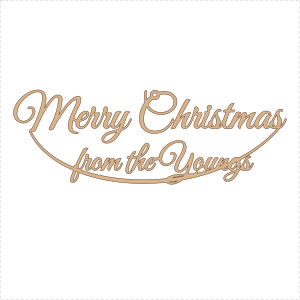
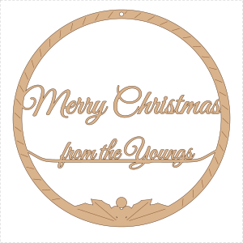
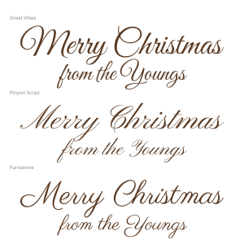

# "Merry Christmas from the Youngs": front-door sign concepts

Three laser-cut designs for the front door, each sized for a **Glowforge Aura
on a 300 × 300 mm sheet**, the same setup as [stocking-template](../stocking-template/).
They're concepts to choose between. Pick one (or mix them) and it can be
refined from there.

All lettering is real outlines in a script font, not live text, so the
Glowforge cuts exactly what you see.

| | Concept | Size | How it's made |
|---|---|---|---|
| 1 | [`svg/door-script.svg`](svg/door-script.svg): **Script & swash** | 273 × 94 mm | Freestanding lettering, cut out. A calligraphic swash runs from the foot of the *M* under "from the Youngs" up to the last *s*, so the whole sign is **one piece**. Hangs level from one ribbon hole above its centre of mass. |
| 2 | [`svg/door-wreath.svg`](svg/door-wreath.svg): **Wreath** | 268 × 268 mm | A ring with scored "ribbon-wrap" marks and a holly-and-berries cluster at the foot. "Merry Christmas" spans the ring and welds into both sides; "from the Youngs" sits on a rail that sweeps up into the ring. One piece that goes straight on a wreath hook. |
| 3 | [`svg/door-bauble.svg`](svg/door-bauble.svg): **Bauble** | 224 × 265 mm | Bauble-shaped plaque with a cap and hanging loop. Lettering is **engraved**, with scored zig-zag bands. The sturdiest option and the finest lettering, because engraving keeps the hairlines. |

<p align="center">
  
  
  
</p>

## Lettering

Concepts 1 and 2 use **Great Vibes**: elegant, with a confident thick-thin
contrast, and its letters join into very few separate pieces, which matters
when you cut script out. Concept 3 uses **Pinyon Script**, a finer copperplate
hand that suits engraving. Any of the three bundled fonts can go on any
concept:

<p align="center"></p>

The fonts are in [`fonts/`](fonts/) under the SIL Open Font License.

## Line colours

| Colour | Hex | Set the step to |
|---|---|---|
| Red | `#FF0000` | **Cut** |
| Blue | `#0000FF` | **Score** |
| Black fill | `#000000` | **Engrave** (concept 3 only) |

## Making cut lettering survive

Script fonts have hairlines thinner than a millimetre, and those snap in ply.
For the cut concepts the generator:

- **grows every letter outward by 0.5 mm** before cutting, so the thinnest
  strokes come out at about 1.5 mm or more after kerf;
- **welds** overlapping letters and joins into one outline, so the laser
  never cuts through a join;
- **ties every loose island** (the *i* dot, a capital that doesn't quite
  touch) to the body with a short 2.2 mm bridge, and refuses to write a file
  unless the result is a single piece.

Each run prints a check:

```
door-script.svg    273.0 x  94.3 mm  sheet edge 13.5 mm  pieces 1  ties  5  thin wood 75.8 mm2
door-wreath.svg    268.0 x 268.0 mm  sheet edge 12.0 mm  pieces 1  ties  4  thin wood 85.7 mm2
door-bauble.svg    224.0 x 265.0 mm  sheet edge 15.0 mm  pieces 1  ties  0  thin wood  0.0 mm2
```

*thin wood* is the area narrower than 1.6 mm. On the cut concepts that's
almost all pointed stroke ends and holly spikes, which taper to a point by
design. Even so, **cut concepts 1 and 2 in 3 mm plywood, not thinner**, and
handle the fresh cut by the frame, not the letters.

## Cutting and finishing

The [stocking-template README](../stocking-template/README.md#cutting-it) has
the full Glowforge walkthrough. In short: upload the SVG, check it reports
the size in the table above, set the colour steps, and test-cut on a scrap
corner first. The Aura is a diode laser, so 3 mm ply is the sweet spot and
expect more than one pass on non-Proofgrade material.

**It's going outdoors**, so seal it. Wipe off the soot, sand lightly, then
paint or stain and finish with two coats of exterior varnish or yacht
varnish, edges included. A porch or a door under a canopy will be kind to it.
Plywood out in the open rain will delaminate within a season.

## Changing the design

```sh
pip install uharfbuzz fonttools skia-pathops shapely
python3 generate_door_sign.py      # rewrites svg/ and preview/
```

The wording lives in `LINE_1` / `LINE_2`, each concept is one function
(`door_script`, `door_wreath`, `door_bauble`), and `CUT_TEXT_GROW`,
`BRIDGE_W` and `MIN_FEATURE` control how robust the cut lettering is.
`scripttext.py` does the font work: HarfBuzz shaping (so the script's joins
and kerning are right) turned into millimetre geometry.
