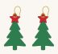
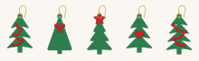

# Christmas tree earrings and car keyring: two layers, green and red

Laser-cut designs for a **Glowforge Aura**. Every piece is two layers, each
cut from its own colour of material and glued together.

## Cut sheets: one job per colour

For the **star-topper earrings** (one pair) plus the **car keyring**, cut
these two files. Each holds every piece of that colour:

| Cut from | File | What's on it |
|---|---|---|
| **Green** | [`svg/cut-sheet-green.svg`](svg/cut-sheet-green.svg) | the keyring's tree + both earring trees |
| **Red** | [`svg/cut-sheet-red.svg`](svg/cut-sheet-red.svg) | the keyring's car backing + both earring stars |

Every design also has its own pair of files, `svg/<design>-green.svg` and
`svg/<design>-red.svg`, if you want to cut one on its own.

### Line colours

| Colour | Hex | Set the step to |
|---|---|---|
| Red | `#FF0000` | **Cut** |
| Blue | `#0000FF` | **Score** (car details and the tree straps) |

The line colour is only the laser step. The *material* colour is which
sheet you load.

## The star-topper earrings (chosen design)

<p align="center"></p>

- **Green layer:** a softly tiered tree, halfway between a smooth triangle
  and a pointy fir, with rounded branch tips. It carries on under the star,
  just inside its edge, so the whole star glues down.
- **Red layer:** the star, glued over the top of the tree.
- One 1.6 mm hole goes through both layers for a 5–6 mm jump ring.
- About 27 × 46 mm. The pair is mirrored left and right.

## The car keyring

<p align="center"></p>

- **Red layer (backing):** the whole car, plus the tree's exact outline, so
  the green tree glues down **flush to the very edges**. The two roof straps
  are solid red bridges: they join the car and tree into one backing piece.
  The window, doors, handles and hubs are scored.
- **Green layer (top):** the tree, with the straps scored across it.
- A 5 mm hole for a split ring sits above the balance point. About 49 × 60 mm.
- Every neck of the backing is at least 2.4 mm wide.

## The other earring ideas

<p align="center"></p>

Ribbon garland, bow, star topper, heart and bauble string. Each has its own
`-green` / `-red` files in [`svg/`](svg/).

## Material and assembly

- Earrings: **1.5–3 mm** plywood or basswood, painted or stained green and
  red. Lighter is kinder on ears. The keyring is fine in 3 mm for both layers.
- Coloured acrylic looks great, but the Aura is a diode laser: it can't cut
  clear acrylic and struggles with some colours. Test-cut a scrap first.
- Glue with a thin smear of wood glue (or two-part epoxy for acrylic), line
  the holes up with a cocktail stick, and press flat until set.
- Seal with a clear varnish so the paint survives being handled.

## Changing the design

```sh
pip install shapely
python3 generate_earrings.py    # rewrites svg/ and preview/, prints a check per design
```
