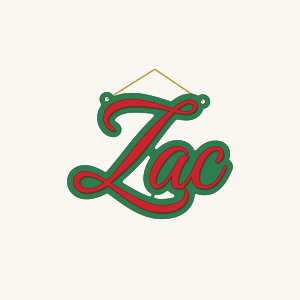
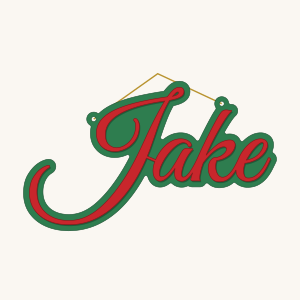

# Zac and Jake: layered name hangers for the wall

Each name is two layers: the name in **red** script, glued onto a **green**
backing that follows the letters with a 6 mm border. Each is cut on a
300 × 300 mm sheet for the Glowforge Aura.

  
  

| Name | Green (backing) | Red (name) | Size |
|---|---|---|---|
| Zac | [`svg/zac-green.svg`](svg/zac-green.svg) | [`svg/zac-red.svg`](svg/zac-red.svg) | 165 × 127 mm |
| Jake | [`svg/jake-green.svg`](svg/jake-green.svg) | [`svg/jake-red.svg`](svg/jake-red.svg) | 253 × 150 mm |

- Both names share one letter size, so they match as a pair when hung
  side by side.
- The script is the door sign's Great Vibes, thickened slightly so the fine
  strokes survive in ply.
- Each name is a single piece, and so is each backing.
- Two **5 mm ribbon holes** in the backing sit either side of the balance
  point, so it hangs level on a ribbon or cord.
- In each file the red name is drawn in its glued-up position, so you can
  lay the two cuts over each other to line them up.
- All lines are `#FF0000`: set them to **Cut**. Use 3 mm plywood for both
  layers.

To change the names or sizes, edit `NAMES`, `NAME_W` or `BORDER` and run
`python3 generate_name_hangers.py`.
